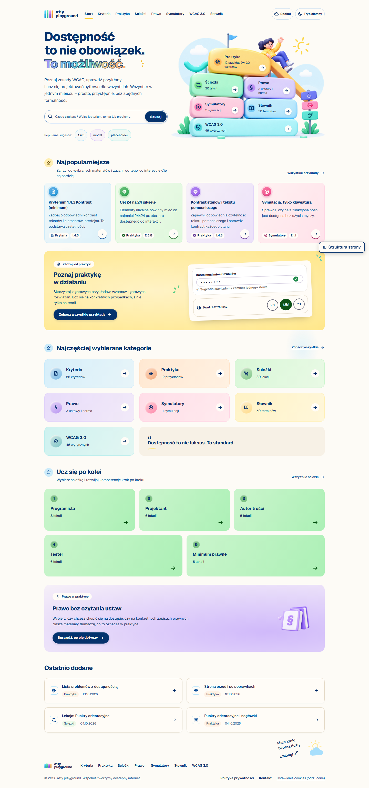
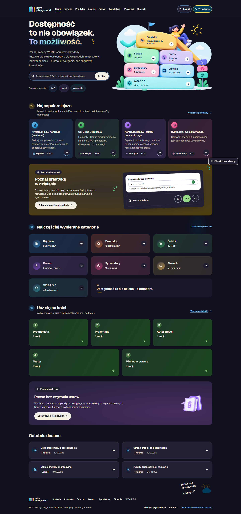
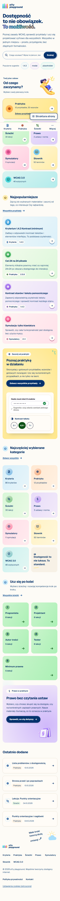
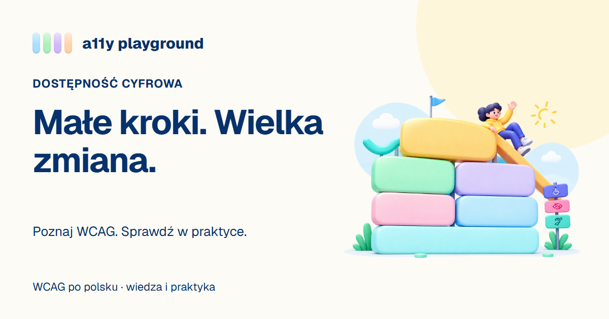

<div align="center">


# a11y playground

**Learn digital accessibility in Polish, from WCAG criteria to working code and legal requirements.**

[](https://github.com/PJasiczek/a11y-playground/actions/workflows/ci.yml)


[Try the app](https://www.a11y-playgrounds.site) · [Features](#features) · [Screenshots](#screenshots) · [Getting started](#getting-started) · [Content](#content) · [Development](#development)

</div>

## Overview

a11y playground helps developers, designers, content authors and testers build more accessible digital products. It connects WCAG explanations, interactive examples and Polish and EU accessibility requirements in one place.

The application is in Polish; the project documentation is in English. Learning progress and self-check notes stay in the browser, with no account required.

## Features

| Area | What you can do |
| --- | --- |
| **WCAG criteria** | Browse 86 entries across levels A, AA and AAA, filter by version, principle or role, and read explanations, testing advice and related legal obligations. The removed criterion 4.1.1 has its own explanation. |
| **Practice** | Compare 12 broken and fixed examples, inspect their code and explore 30 interactive ARIA patterns with keyboard exercises, live attribute values and a simulated screen reader log. |
| **Before and after** | Audit a fictional transport operator's website with 20 accessibility problems. Take notes before revealing the fixes and numbered problem markers. |
| **Simulators** | Explore 11 simulation options in six groups: colour vision, low vision, keyboard, screen reader, narrow screen and page structure. Each explains its limits and provides text alongside the visual effect. |
| **Learning paths** | Follow five paths with 30 lessons, quizzes and local progress for developers, designers, content authors, testers and the legal minimum for public bodies. |
| **Law** | Read three Polish acts and an EN 301 549 overview, compare provisions with plain-language summaries and use a timeline to explore obligations for your situation. |
| **Search and glossary** | Search criteria, examples, patterns, provisions, lessons, WCAG 3.0 guidelines and 50 glossary terms. Search ignores Polish diacritics. |
| **WCAG 3.0** | Explore the draft overview and our mapping of 46 guidelines to WCAG 2.2. The page identifies the draft date and clearly labels the mapping as our interpretation. |

The interface uses a cream background, navy text, pastel section colours and an illustrated home page. Search is available in the home-page hero and at `/szukaj`. On wide screens, the logo, navigation and preference controls share one header row; the active link has a yellow underline. On phones, three navigation tabs and a **Więcej** sheet sit at the bottom.

Light and dark themes follow the system until explicitly changed. **Spokój** (calm mode) disables motion and simplifies section colours. **Struktura strony** outlines and lists page landmarks and headings.

> [!NOTE]
> Simulators and their screen reader logs are learning aids. They do not replace testing with assistive technology. The legal module provides educational material, not legal advice.

## Screenshots

These home-page captures show the current redesign in light, dark and mobile layouts.

| Light | Dark | Mobile |
| --- | --- | --- |
| [](docs/screenshots/home-light.png) | [](docs/screenshots/home-dark.png) | [](docs/screenshots/home-mobile.png) |

Other files in `docs/screenshots/` include earlier designs and intermediate captures; they are not a gallery of the current interface.

## Getting started

### Prerequisites

- [Node.js](https://nodejs.org) 24 or newer.
- [pnpm](https://pnpm.io) 11; the exact version is pinned in `package.json`.
- A Notion integration with access to the project's content root page.

Clone the repository and install dependencies:

```bash
git clone https://github.com/PJasiczek/a11y-playground.git
cd a11y-playground
pnpm install
```

Create a git-ignored `.env.local` file in the project root:

```dotenv
NOTION_TOKEN=<your-notion-integration-token>
NOTION_ROOT_PAGE_ID=<content-root-page-id>
```

Import the content and start the development server:

```bash
pnpm import:notion
pnpm dev
```

Open the local URL printed by Vite. Run `pnpm import:notion` again when you want to fetch content changes.

> [!IMPORTANT]
> A fresh clone needs Notion access: content Markdown is generated and excluded from Git. Quizzes and the HTML for examples, patterns and the before-and-after demo are versioned in the repository.

To serve a production build locally:

```bash
pnpm build
pnpm preview
```

On Windows, if PowerShell blocks `pnpm.ps1`, use `pnpm.cmd` for the same commands.

## Content

Notion is the source for explanations, glossary entries, legal summaries, lessons and other Markdown content. The importer writes these pages to `content/`; every production build imports them again. Edit the source in Notion, because the next import replaces local Markdown changes.

The [content authoring guide](docs/content-authoring.md) covers Notion layout, frontmatter, required sections, quizzes, example HTML, cross-links and source imports.

- `pnpm import:wcag` regenerates WCAG metadata and normative text.
- `pnpm import:legal` regenerates statute data from the Sejm ELI API.
- `pnpm seed:notion` is a one-time migration utility for an empty Notion root.

Generated source updates should be reviewed before shipping. Polish normative WCAG text comes from the authorized WCAG 2.1 translation; criteria introduced in 2.2 link to their sources.

## Development

### Commands

| Command | Purpose |
| --- | --- |
| `pnpm dev` | Start the Vite development server. |
| `pnpm build` | Import Notion content and build the production app into `.output/`. |
| `pnpm preview` | Serve the production build locally. |
| `pnpm generate:social` | Export versioned Open Graph, X and square PNG artwork using installed Chromium. |
| `pnpm lint` | Run ESLint, including accessibility rules, and TypeScript checks. |
| `pnpm test` | Run Vitest, then Playwright against a production build. |
| `pnpm import:notion` | Refresh local content from Notion. |
| `pnpm import:wcag` | Regenerate WCAG metadata and text. |
| `pnpm import:legal` | Regenerate legal source data. |
| `pnpm seed:notion` | Seed an empty Notion root; refuses to overwrite an existing one. |

### Validation

Install Chromium once before running the end-to-end suite:

```bash
pnpm exec playwright install chromium
pnpm lint
pnpm test
```

Vitest checks content schemas, cross-references, search and application logic. Playwright checks accessibility with axe, keyboard flows, target sizes, motion, consent and interactive learning features. Its server setup builds the app, imports Notion content and serves it on port 4173; it can reuse an existing server outside CI.

GitHub Actions runs lint, build and tests on pull requests and pushes to `master`. CI needs `NOTION_TOKEN` and `NOTION_ROOT_PAGE_ID` as repository secrets.

### Accessibility

The target is WCAG 2.2 AA, with additional AAA checks for enhanced contrast, animation from interactions, focus appearance and target size. The app includes keyboard navigation, a skip link, route announcements, visible focus and reduced-motion support.

See the [accessibility checklist](docs/accessibility.md) and [design system](DESIGN.md). Automated checks cover only part of accessibility; releases also need manual screen reader testing.

### Architecture

- **TanStack Start, React and TypeScript** provide file-based routes and server functions.
- **Vite and Nitro** build the app and prerender its pages; Nitro selects the Vercel preset when built on Vercel.
- **Tailwind CSS v4** and CSS tokens handle themes and section colours. Geist is used for interface text; Atkinson Hyperlegible Mono is used for code.
- **ArkType, marked and YAML** validate and render content.
- **MiniSearch** powers search with a prerendered index loaded on the search route.
- **Vitest, Playwright and axe-core** validate data, behaviour and accessibility.

```text
content/             Imported Markdown, versioned quizzes and demo HTML
scripts/             Notion, WCAG and legal import utilities
src/
  components/        Shared UI, learning tools and sandboxed frames
  content/           Parsers, validation, generated data and server functions
  lib/               SEO, consent, quiz scoring and shared utilities
  progress/          Browser-local learning progress and notes
  routes/            App pages, demo endpoints and the Notion webhook
  search/            Search index generation and relevance tests
  styles.css         Shared design tokens and styles
  home.css           Home-page layout and illustration styles
  header.css         Brand and responsive navigation styles
e2e/                 Browser tests
public/              Favicon and illustration assets
docs/                Guides, design history and screenshots
```

## Deployment

### SEO and shared links

Every indexed page has a prerendered title, description, canonical URL and social metadata in its initial HTML. The sitemap and robots.txt are generated from the shared route catalogue; hidden demos, answers and search results are excluded. XML values are escaped and duplicate canonical URLs are removed. `lastmod` is intentionally omitted until reliable page-level modification dates are available.

`src/lib/social.ts` selects a brand fallback, a section card, or an individual WCAG criterion card. The versioned PNGs in `public/social/` are committed assets: ordinary builds do not need a browser to export them. After changing card copy, criteria or artwork, install Chromium and run `pnpm generate:social`. The offline exporter uses the existing Geist font and playground illustration, checks title overflow, and emits 1200×630 Open Graph cards, dedicated 1200×600 X cards, and a 1080×1080 image for manual posts. It reads no external services. Bump the filename version in both metadata and exporter when replacing published images to avoid stale social caches.



The implementation follows the [SEO plan and artwork proposals](docs/design/2026-11-01-seo/plan-seo.html): brand card A is the fallback and content template B provides criterion-specific titles, using the existing illustration for visual consistency. Section pages use descriptive search titles; individual content titles remain tied to their content. Social tags include absolute image URLs, MIME type, dimensions and alt text, with `summary_large_image` for X. Playwright checks the initial HTML, unique titles/descriptions, image responses and dimensions, sitemap coverage and real HTTP 404s.

The Notion importer accepts links authored on the original Vercel domain as internal links too, preserving glossary previews and legal references during the domain migration. New exports use the current canonical host.

Vercel builds with `VERCEL_ENV=preview` include a root `noindex` directive. Keep preview deployments protected at the platform level too; reuse of a production build will retain its production indexing policy.

After deployment, submit `/sitemap.xml` in Google Search Console and inspect representative URLs. Check real link previews using Facebook Sharing Debugger, LinkedIn Post Inspector and target messaging apps, then compare Search Console indexing, queries and CTR after 2–4 weeks. These account-dependent checks are manual; local tests cannot establish production indexing or clear platform caches. See the [release checklist](docs/seo-release.md).

Deploy using `pnpm build` with `NOTION_TOKEN` and `NOTION_ROOT_PAGE_ID` configured in the hosting environment. The production address used by canonical URLs and the sitemap is defined in [src/lib/site.ts](src/lib/site.ts).

To publish content changes automatically, configure a Notion webhook at `/api/notion-webhook`, a `NOTION_WEBHOOK_SECRET` and a `VERCEL_DEPLOY_HOOK_URL`. See the [publishing setup](docs/content-authoring.md#editing-content-in-notion) for the verification steps.

### Optional analytics

Set `VITE_GA_MEASUREMENT_ID` for production builds to enable Google Analytics 4. Without it, the consent card, cookie settings and analytics script are absent. With it, the script loads only after consent; readers can reopen cookie settings from the footer and withdraw consent.

## Project status

The learning modules, legal mapping, simulators, ARIA patterns, page-structure tool and whole-page audit are implemented. Accounts and cloud-synced progress are postponed; progress currently stays in the browser.

See the [original roadmap](docs/design/2026-09-27-wcag-learning-app/wcag-learning-app.en.html) and [redesign plan](docs/design/2026-10-31-pastel-redesign.md) for scope and design history.
